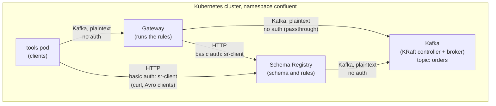

# CEL Rules with Gateway

This example shows Gateway centralized governance enforcement with data quality rules:
- **CEL rule**:
  Gateway rejects an order on `orders` when `quantity` is not greater than 0.
  The rule checks the full record.
- **CEL_FIELD rule**:
  Gateway rejects an order on `orders` when a string field is empty.
  The rule checks each field of type string.

Both rules are `CONDITION` rules in the schema's rule set.
Clients do not run the rules.

## Overview

The example deploys these components in the `confluent` namespace:

| Component       | Configuration                                                                          |
|-----------------|----------------------------------------------------------------------------------------|
| KRaft and Kafka | One controller and one broker, PLAINTEXT listeners                                     |
| Schema Registry | HTTP with basic authentication, rule-set extension                                     |
| Gateway         | Passthrough route, port-based routing, `policies.dataGovernance` with Schema Registry |
| Topic           | `orders`                                                                               |
| Schema          | `Order` on the `orders-value` subject, with a CEL rule and a CEL_FIELD rule            |
| Tools pod       | curl, and plain and Avro console tools                                                 |



The [order-rules.json](./schemas/order-rules.json) file sets the rules:

| Rule                | Type        | Expression                           | Rejects                               |
|---------------------|-------------|--------------------------------------|---------------------------------------|
| `quantity-positive` | `CEL`       | `message.quantity > 0`               | An order with `quantity` of 0 or less |
| `strings-not-empty` | `CEL_FIELD` | `typeName == 'STRING' ; value != ''` | An order with an empty string field   |

A `CEL_FIELD` expression has two parts.
The part before `;` selects the fields.
The part after `;` is the condition for each selected field.

The rule set has `enableAt: GATEWAY`.
Thus Gateway runs the rules, and clients skip them.
Both rules have `mode: WRITE`, thus Gateway runs them when clients produce.
The [gateway.yaml](./gateway.yaml) file sets the policy:

```yaml
policies:
  dataGovernance:
    schemaRegistry:
      urls:
        - http://schemaregistry.confluent.svc.cluster.local:8081
      authentication:
        type: basic
        basic:
          secretRef: sr-client-credentials
    key:
      enabled: false
    value:
      enabled: true
      subjectNameStrategy: TOPIC
```

For the licenses, see [Licenses](../README.md#licenses).

## Prerequisites

- Please ensure that you have set up the
  [prerequisites](https://github.com/confluentinc/confluent-kubernetes-examples/blob/master/README.md#prerequisites)
  for using the examples in this repo.
- CFK 3.4.0 or later.
  CFK 3.4.0 adds `policies.dataGovernance` to the Gateway CRD.
- [jq](https://jqlang.org/) on the host.
  Step 5 uses `jq` to make the schema registration request.
- Internet access from the cluster.
  The tools pod downloads the Confluent Community package.

## Deploy the Example

### Step 1: Deploy the Confluent for Kubernetes Operator

- Add the Confluent Helm repository
```
helm repo add confluentinc https://packages.confluent.io/helm
helm repo update
```
- Create the `confluent` namespace in the Kubernetes cluster
```
kubectl create namespace confluent
```
- Install the CFK operator
```
helm upgrade --install confluent-operator confluentinc/confluent-for-kubernetes -n confluent
```
- Check that the `confluent-operator` pod comes up and is running:
```
kubectl get pods -n confluent
```

### Step 2: Create the Schema Registry credentials

- Create the Schema Registry user `sr-client`.
  Schema Registry reads one `<user>: <password>,<role>` line for each user.
```
kubectl create secret generic sr-basic-users -n confluent \
  --from-literal=basic.txt='sr-client: sr-client-secret,sr-user'
```
- Create the credentials of the `sr-client` user.
  Gateway reads `basic.txt`.
  The tools pod mounts `client.properties` for the Avro console tools and `curl.config` for curl.
```
kubectl create secret generic sr-client-credentials -n confluent \
  --from-literal=basic.txt=$'username=sr-client\npassword=sr-client-secret' \
  --from-literal=client.properties=$'basic.auth.credentials.source=USER_INFO\nbasic.auth.user.info=sr-client:sr-client-secret' \
  --from-literal=curl.config='user = "sr-client:sr-client-secret"'
```

### Step 3: Deploy Kafka and Schema Registry

- Deploy the KRaft controller and Kafka
```
kubectl apply -f confluent-platform.yaml
```
- Wait for Kafka to become RUNNING
```
kubectl wait --for=jsonpath='{.status.phase}'=RUNNING kraftcontroller/kraftcontroller kafka/kafka --timeout=900s -n confluent
```
- Deploy Schema Registry.
  Schema Registry connects to Kafka when it starts, thus deploy it after Kafka is RUNNING.
```
kubectl apply -f schema-registry.yaml
```
- Wait for Schema Registry to become RUNNING
```
kubectl wait --for=jsonpath='{.status.phase}'=RUNNING schemaregistry/schemaregistry --timeout=600s -n confluent
```

> **Note:** Without a license, the Schema Registry log shows `License validation failed` errors.
> These errors are expected.
> Schema Registry accepts the CEL and CEL_FIELD rules of this example without a license.

### Step 4: Deploy the tools pod

- Deploy the tools pod
```
kubectl apply -f tools.yaml
```
- Wait for the tools pod to become READY.
  The pod is READY when the console tools are installed.
```
kubectl wait --for=condition=Ready pod/tools --timeout=900s -n confluent
```

### Step 5: Create the topic and register the schema

The CFK Schema CR does not support rule sets.
Thus this step registers the schema with the Schema Registry REST API.
`jq` puts the [order.avsc](./schemas/order.avsc) schema and the
[order-rules.json](./schemas/order-rules.json) rule set into one request body, and curl in the tools
pod sends the body to Schema Registry.

- Create the `orders` topic
```
kubectl apply -f topics.yaml
```
- Register the `Order` schema on the `orders-value` subject.
  Make a note of the `id` in the response.
```
jq -n \
  --rawfile schema schemas/order.avsc \
  --slurpfile ruleSet schemas/order-rules.json \
  '{schemaType: "AVRO", schema: $schema, ruleSet: $ruleSet[0]}' \
| kubectl exec -i tools -n confluent -- curl -s \
    --config /etc/sr-client/curl.config \
    -H 'Content-Type: application/vnd.schemaregistry.v1+json' \
    --data @- \
    http://schemaregistry.confluent.svc.cluster.local:8081/subjects/orders-value/versions
```

### Step 6: Deploy Gateway

- Deploy the gateway yaml
```
kubectl apply -f gateway.yaml
```
- Wait for Gateway to become RUNNING
```
kubectl wait --for=jsonpath='{.status.phase}'=RUNNING gateway/confluent-gateway --timeout=600s -n confluent
```

## Testing the Configuration

1. Open a shell in the tools pod.
   Run the next steps in this shell.
   Replace `<schema-id>` with the ID from step 5.
```
kubectl exec -it tools -n confluent -- bash
```
```
ID=<schema-id>
```

2. Produce a valid order through Gateway.
   Both rules pass, and Gateway accepts the record.
```
echo '{"order_id": "o-1", "item": "keyboard", "quantity": 2}' | kafka-avro-console-producer \
  --bootstrap-server confluent-gateway.confluent.svc.cluster.local:9092 \
  --topic orders \
  --reader-property schema.registry.url=http://schemaregistry.confluent.svc.cluster.local:8081 \
  --reader-config /etc/sr-client/client.properties \
  --reader-property auto.register.schemas=false \
  --reader-property value.schema.id="$ID"
```

3. Produce an order with `quantity` of 0.
   The `quantity-positive` rule fails.
```
echo '{"order_id": "o-2", "item": "mouse", "quantity": 0}' | kafka-avro-console-producer \
  --bootstrap-server confluent-gateway.confluent.svc.cluster.local:9092 \
  --topic orders \
  --reader-property schema.registry.url=http://schemaregistry.confluent.svc.cluster.local:8081 \
  --reader-config /etc/sr-client/client.properties \
  --reader-property auto.register.schemas=false \
  --reader-property value.schema.id="$ID"
```
Gateway rejects the record:
```
org.apache.kafka.common.InvalidRecordException: confluent-gateway governance: origin=RECORD_SCHEMA_RULE | Error serializing Avro message
```

4. Produce an order with an empty `item`.
   The `strings-not-empty` rule fails.
```
echo '{"order_id": "o-3", "item": "", "quantity": 1}' | kafka-avro-console-producer \
  --bootstrap-server confluent-gateway.confluent.svc.cluster.local:9092 \
  --topic orders \
  --reader-property schema.registry.url=http://schemaregistry.confluent.svc.cluster.local:8081 \
  --reader-config /etc/sr-client/client.properties \
  --reader-property auto.register.schemas=false \
  --reader-property value.schema.id="$ID"
```
Gateway rejects the record with the same error as in step 3.

5. Consume `orders` through Gateway.
   The consumer shows only the valid order from step 2.
```
kafka-avro-console-consumer \
  --bootstrap-server confluent-gateway.confluent.svc.cluster.local:9092 \
  --topic orders \
  --from-beginning \
  --formatter-property schema.registry.url=http://schemaregistry.confluent.svc.cluster.local:8081 \
  --formatter-config /etc/sr-client/client.properties
```

6. Exit the tools pod.
   On the host, show which rule caused each rejection.
   The error that the client gets does not include the rule name, but the Gateway log does.
```
kubectl logs deploy/confluent-gateway -n confluent | grep 'Rule failed'
```
The log shows one line for each rejected record:
```
Caused by: org.apache.kafka.common.errors.SerializationException: Rule failed: quantity-positive
Caused by: org.apache.kafka.common.errors.SerializationException: Rule failed: strings-not-empty
```

## Clean Up

To remove all resources created by this example:

- Delete the tools pod, Gateway, topic and Confluent Platform.
  Wait for the command to complete before you uninstall the CFK operator.
```
kubectl delete -f tools.yaml -f gateway.yaml -f topics.yaml -f schema-registry.yaml -f confluent-platform.yaml
```
- Delete the secrets
```
kubectl delete secret sr-basic-users sr-client-credentials -n confluent
```
- Uninstall the CFK operator
```
helm uninstall confluent-operator -n confluent
```
- Delete the `confluent` namespace
```
kubectl delete namespace confluent
```
