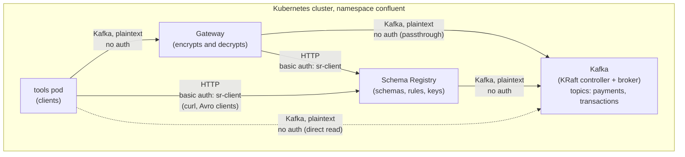

# Encryption with Gateway

This example shows Gateway centralized governance enforcement with:
- **GW field-level encryption (GWFLE)**:
  Gateway encrypts the `card_number` field of each record on `payments`.
  The schema tags the field as `PII`.
- **GW payload encryption (GWPE)**:
  Gateway encrypts the full value of each record on `transactions`.

Gateway encrypts the records when clients produce, and decrypts them when clients consume.
Clients do not need encryption configuration.
The broker stores only the encrypted data.

## Overview

The example deploys these components in the `confluent` namespace:

| Component       | Configuration                                                                                     |
|-----------------|---------------------------------------------------------------------------------------------------|
| KRaft and Kafka | One controller and one broker, PLAINTEXT listeners                                                |
| Schema Registry | HTTP with basic authentication, rule-set and DEK registry extensions, CSFLE add-on license        |
| Gateway         | Passthrough route, port-based routing, `policies.dataGovernance` with encryption rule executors |
| Topics          | `payments` (field encryption) and `transactions` (payload encryption)                             |
| Schemas         | `Payment` on `payments-value` and `Transaction` on `transactions-value`, with encryption rules    |
| Tools pod       | curl, and plain and Avro console tools                                                            |



Each schema has a rule set with `enableAt: GATEWAY`.
Thus Gateway runs the encryption rules, and clients skip them.
Gateway stores the data encryption keys in the Schema Registry DEK registry.
The `local-kms` driver in Gateway derives the key-encryption key from `local-kms-secret`.
The [gateway.yaml](./gateway.yaml) file sets the policy:

```yaml
policies:
  dataGovernance:
    schemaRegistry:
      urls:
        - http://schemaregistry.confluent.svc.cluster.local:8081
      authentication:
        type: basic
        basic:
          secretRef: sr-client-credentials
      ruleExecutors:
        - name: encryptField
          class: io.confluent.kafka.schemaregistry.encryption.FieldEncryptionExecutor
          secretRef: local-kms-secret
        - name: encryptPayload
          class: io.confluent.kafka.schemaregistry.encryption.EncryptionExecutor
          secretRef: local-kms-secret
    key:
      enabled: false
    value:
      enabled: true
      subjectNameStrategy: TOPIC
```

> **Note:** The `local-kms` driver is for testing only.
> Use a cloud KMS or HashiCorp Vault in production.

## Prerequisites

- Please ensure that you have set up the
  [prerequisites](https://github.com/confluentinc/confluent-kubernetes-examples/blob/master/README.md#prerequisites)
  for using the examples in this repo.
- CFK 3.4.0 or later.
  CFK 3.4.0 adds `policies.dataGovernance` to the Gateway CRD.
- [jq](https://jqlang.org/) on the host.
  Step 5 uses `jq` to make the schema registration requests.
- A Confluent license file for Schema Registry.
  Schema Registry rejects encryption rules without a license.
  For the license that each Gateway product needs, see [Licenses](../README.md#licenses).
- Internet access from the cluster.
  The tools pod downloads the Confluent Community package.

## Deploy the Example

### Step 1: Deploy the Confluent for Kubernetes Operator

- Add the Confluent Helm repository
```
helm repo add confluentinc https://packages.confluent.io/helm
helm repo update
```
- Create the `confluent` namespace in the Kubernetes cluster
```
kubectl create namespace confluent
```
- Install the CFK operator
```
helm upgrade --install confluent-operator confluentinc/confluent-for-kubernetes -n confluent
```
- Check that the `confluent-operator` pod comes up and is running:
```
kubectl get pods -n confluent
```

### Step 2: Create the secrets

- Create the license secret.
  Replace `<license-file>` with the path to your license file.
  CFK reads the license as `license=<license>` from `license.txt`.
```
kubectl create secret generic confluent-license -n confluent \
  --from-literal=license.txt="license=$(cat <license-file>)"
```
- Create the Schema Registry user `sr-client`.
  Schema Registry reads one `<user>: <password>,<role>` line for each user.
```
kubectl create secret generic sr-basic-users -n confluent \
  --from-literal=basic.txt='sr-client: sr-client-secret,sr-user'
```
- Create the credentials of the `sr-client` user.
  Gateway reads `basic.txt`.
  The tools pod mounts `client.properties` for the Avro console tools and `curl.config` for curl.
```
kubectl create secret generic sr-client-credentials -n confluent \
  --from-literal=basic.txt=$'username=sr-client\npassword=sr-client-secret' \
  --from-literal=client.properties=$'basic.auth.credentials.source=USER_INFO\nbasic.auth.user.info=sr-client:sr-client-secret' \
  --from-literal=curl.config='user = "sr-client:sr-client-secret"'
```
- Create the secret of the `local-kms` driver.
  Gateway derives the key-encryption key from this value.

> **Note:** If you change this value, Gateway cannot decrypt the records that it encrypted before
> the change.

```
kubectl create secret generic local-kms-secret -n confluent \
  --from-literal=secret=example-local-kms-secret
```

### Step 3: Deploy Kafka and Schema Registry

- Deploy the KRaft controller and Kafka
```
kubectl apply -f confluent-platform.yaml
```
- Wait for Kafka to become RUNNING
```
kubectl wait --for=jsonpath='{.status.phase}'=RUNNING kraftcontroller/kraftcontroller kafka/kafka --timeout=900s -n confluent
```
- Deploy Schema Registry.
  Schema Registry connects to Kafka when it starts, thus deploy it after Kafka is RUNNING.
```
kubectl apply -f schema-registry.yaml
```
- Wait for Schema Registry to become RUNNING
```
kubectl wait --for=jsonpath='{.status.phase}'=RUNNING schemaregistry/schemaregistry --timeout=600s -n confluent
```

### Step 4: Deploy the tools pod

- Deploy the tools pod
```
kubectl apply -f tools.yaml
```
- Wait for the tools pod to become READY.
  The pod is READY when the console tools are installed.
```
kubectl wait --for=condition=Ready pod/tools --timeout=900s -n confluent
```

### Step 5: Create the topics and register the schemas

The CFK Schema CR does not support rule sets.
Thus this step registers the schemas with the Schema Registry REST API.

- Create the `payments` and `transactions` topics
```
kubectl apply -f topics.yaml
```
Each schema has two files: the Avro schema and its rule set.
`jq` puts the two files into one request body, and curl in the tools pod sends the body to Schema
Registry.

- Register the `Payment` schema on the `payments-value` subject.
  The [payment.avsc](./schemas/payment.avsc) file tags `card_number` as `PII`.
  The [payment-rules.json](./schemas/payment-rules.json) file has an `ENCRYPT` rule for fields
  tagged `PII`.
  Make a note of the `id` in the response.
```
jq -n \
  --rawfile schema schemas/payment.avsc \
  --slurpfile ruleSet schemas/payment-rules.json \
  '{schemaType: "AVRO", schema: $schema, ruleSet: $ruleSet[0]}' \
| kubectl exec -i tools -n confluent -- curl -s \
    --config /etc/sr-client/curl.config \
    -H 'Content-Type: application/vnd.schemaregistry.v1+json' \
    --data @- \
    http://schemaregistry.confluent.svc.cluster.local:8081/subjects/payments-value/versions
```
- Register the `Transaction` schema on the `transactions-value` subject.
  The [transaction-rules.json](./schemas/transaction-rules.json) file has an `ENCRYPT_PAYLOAD` rule
  for the [transaction.avsc](./schemas/transaction.avsc) schema.
  Make a note of the `id` in the response.
```
jq -n \
  --rawfile schema schemas/transaction.avsc \
  --slurpfile ruleSet schemas/transaction-rules.json \
  '{schemaType: "AVRO", schema: $schema, ruleSet: $ruleSet[0]}' \
| kubectl exec -i tools -n confluent -- curl -s \
    --config /etc/sr-client/curl.config \
    -H 'Content-Type: application/vnd.schemaregistry.v1+json' \
    --data @- \
    http://schemaregistry.confluent.svc.cluster.local:8081/subjects/transactions-value/versions
```

### Step 6: Deploy Gateway

- Deploy the gateway yaml
```
kubectl apply -f gateway.yaml
```
- Wait for Gateway to become RUNNING
```
kubectl wait --for=jsonpath='{.status.phase}'=RUNNING gateway/confluent-gateway --timeout=600s -n confluent
```

## Testing the Configuration

1. Open a shell in the tools pod.
   Run the next steps in this shell.
   Replace `<payment-schema-id>` and `<transaction-schema-id>` with the IDs from step 5.
```
kubectl exec -it tools -n confluent -- bash
```
```
PAYMENT_ID=<payment-schema-id>
TRANSACTION_ID=<transaction-schema-id>
```

2. Produce a payment through Gateway.
   Gateway encrypts the `card_number` field.
```
echo '{"payment_id": "p-1", "card_number": "4111-1111-1111-1111", "amount": 42.5}' | kafka-avro-console-producer \
  --bootstrap-server confluent-gateway.confluent.svc.cluster.local:9092 \
  --topic payments \
  --reader-property schema.registry.url=http://schemaregistry.confluent.svc.cluster.local:8081 \
  --reader-config /etc/sr-client/client.properties \
  --reader-property auto.register.schemas=false \
  --reader-property value.schema.id="$PAYMENT_ID"
```

3. Produce a transaction through Gateway.
   Gateway encrypts the full record value.
```
echo '{"txn_id": "t-1", "account": "acct-9", "amount": 10.0}' | kafka-avro-console-producer \
  --bootstrap-server confluent-gateway.confluent.svc.cluster.local:9092 \
  --topic transactions \
  --reader-property schema.registry.url=http://schemaregistry.confluent.svc.cluster.local:8081 \
  --reader-config /etc/sr-client/client.properties \
  --reader-property auto.register.schemas=false \
  --reader-property value.schema.id="$TRANSACTION_ID"
```

4. Consume `payments` through Gateway.
   Gateway decrypts the `card_number` field.
```
kafka-avro-console-consumer \
  --bootstrap-server confluent-gateway.confluent.svc.cluster.local:9092 \
  --topic payments \
  --from-beginning \
  --formatter-property schema.registry.url=http://schemaregistry.confluent.svc.cluster.local:8081 \
  --formatter-config /etc/sr-client/client.properties
```
The consumer shows the record as it was produced:
```
{"payment_id":"p-1","card_number":"4111-1111-1111-1111","amount":42.5}
```

5. Consume `payments` directly from the broker.
   The Avro consumer decodes the record, but does not decrypt it.
```
kafka-avro-console-consumer \
  --bootstrap-server kafka.confluent.svc.cluster.local:9071 \
  --topic payments \
  --from-beginning \
  --formatter-property schema.registry.url=http://schemaregistry.confluent.svc.cluster.local:8081 \
  --formatter-config /etc/sr-client/client.properties
```
The `payment_id` and `amount` fields are in plain text.
The `card_number` field is ciphertext.
Your ciphertext is different from this example:
```
{"payment_id":"p-1","card_number":"DiY+Zi2+iOEWdnsbhAml1mBfx0rIFIrUKku0IEYMdYGMLHz34fBYdt0f3Jv7rSg=","amount":42.5}
```

6. Consume `transactions` through Gateway.
   Gateway decrypts the full record value.
```
kafka-avro-console-consumer \
  --bootstrap-server confluent-gateway.confluent.svc.cluster.local:9092 \
  --topic transactions \
  --from-beginning \
  --formatter-property schema.registry.url=http://schemaregistry.confluent.svc.cluster.local:8081 \
  --formatter-config /etc/sr-client/client.properties
```
The consumer shows the record as it was produced:
```
{"txn_id":"t-1","account":"acct-9","amount":10.0}
```

7. Consume `transactions` directly from the broker.
```
kafka-console-consumer \
  --bootstrap-server kafka.confluent.svc.cluster.local:9071 \
  --topic transactions \
  --from-beginning
```
The full record value is ciphertext.
The output shows binary data, and none of the field values `t-1` or `acct-9`.

## Clean Up

To remove all resources created by this example:

- Delete the tools pod, Gateway, topics and Confluent Platform
```
kubectl delete -f tools.yaml -f gateway.yaml -f topics.yaml -f schema-registry.yaml -f confluent-platform.yaml
```
- Delete the secrets
```
kubectl delete secret confluent-license sr-basic-users sr-client-credentials local-kms-secret -n confluent
```
- Uninstall the CFK operator
```
helm uninstall confluent-operator -n confluent
```
- Delete the `confluent` namespace
```
kubectl delete namespace confluent
```
