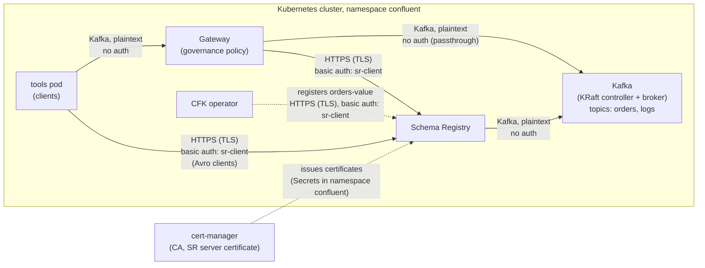

# Schema Validation with Gateway and Schema Registry over TLS

This example shows Gateway centralized governance enforcement with Schema Registry over TLS.
Gateway connects to Schema Registry over HTTPS with basic authentication.
cert-manager issues the Schema Registry server certificate.
The example shows:
- **Schema ID enforcement**:
  Gateway rejects records that do not have a schema ID.
- **Deep schema validation**:
  Gateway rejects records with a payload that does not agree with the schema.
- **Per-topic override**:
  Gateway does not govern the `logs` topic.

## Overview

The example deploys these components in the `confluent` namespace:

| Component       | Configuration                                                                          |
|-----------------|----------------------------------------------------------------------------------------|
| KRaft and Kafka | One controller and one broker, PLAINTEXT listeners                                     |
| cert-manager    | Self-signed CA and the Schema Registry server certificate                              |
| Schema Registry | HTTPS (TLS) with basic authentication                                                  |
| Gateway         | Passthrough route, port-based routing, `policies.dataGovernance` with Schema Registry |
| Topics          | `orders` (governed) and `logs` (not governed)                                          |
| Schema          | `Order` Avro schema on the `orders-value` subject                                      |
| Tools pod       | Plain and Avro console tools                                                           |



Clients connect to Gateway at `confluent-gateway.confluent.svc.cluster.local:9092`.
Gateway gets the schema of each record value from Schema Registry.
The [gateway.yaml](./gateway.yaml) file sets the policy:

```yaml
policies:
  dataGovernance:
    schemaRegistry:
      urls:
        - https://schemaregistry.confluent.svc.cluster.local:8081
      authentication:
        type: basic
        basic:
          secretRef: sr-client-credentials
      tls:
        enabled: true
        secretRef: ca-cert
    key:
      enabled: false
    value:
      enabled: true
      subjectNameStrategy: TOPIC
    topics:
      - name: logs
        value:
          enabled: false
```

The `ca-cert` secret has only the CA certificate in the `ca.crt` key.
CFK creates a truststore from it.
Gateway, the CFK `Schema` CR and the tools pod use the CA certificate to trust Schema Registry.
Kafka uses PLAINTEXT listeners.

Schema ID enforcement and deep schema validation do not need Schema Registry extensions.
For the licenses, see [Licenses](../README.md#licenses).

## Prerequisites

- Please ensure that you have set up the
  [prerequisites](https://github.com/confluentinc/confluent-kubernetes-examples/blob/master/README.md#prerequisites)
  for using the examples in this repo.
- CFK 3.4.0 or later.
  CFK 3.4.0 adds `policies.dataGovernance` to the Gateway CRD.
- Internet access from the cluster.
  The tools pod downloads the Confluent Community package.
  Step 2 downloads cert-manager.

## Deploy the Example

### Step 1: Deploy the Confluent for Kubernetes Operator

- Add the Confluent Helm repository
```
helm repo add confluentinc https://packages.confluent.io/helm
helm repo update
```
- Create the `confluent` namespace in the Kubernetes cluster
```
kubectl create namespace confluent
```
- Install the CFK operator
```
helm upgrade --install confluent-operator confluentinc/confluent-for-kubernetes -n confluent
```
- Check that the `confluent-operator` pod comes up and is running:
```
kubectl get pods -n confluent
```

### Step 2: Create the certificates

- Install cert-manager.
  Skip this step if cert-manager is already in the cluster.
```
kubectl apply -f https://github.com/cert-manager/cert-manager/releases/download/v1.21.2/cert-manager.yaml
```
- Wait for the cert-manager deployments to become available
```
kubectl wait --for=condition=Available deployment --all --timeout=300s -n cert-manager
```
- Create the CA and the Schema Registry server certificate.
  If the cert-manager webhook is not ready yet, the command fails.
  In that case, wait a short time and run the command again.
```
kubectl apply -f certs.yaml
```
- Wait for the certificates to become ready
```
kubectl wait --for=condition=Ready certificate --all --timeout=180s -n confluent
```
- Create the `ca-cert` secret with only the CA certificate.
  Gateway, CFK and the tools pod trust this CA.
  They do not get the CA key.
```
kubectl create secret generic ca-cert -n confluent \
  --from-file=ca.crt=<(kubectl get secret ca-key-pair -n confluent -o jsonpath='{.data.ca\.crt}' | base64 -d)
```

### Step 3: Create the Schema Registry credentials

- Create the Schema Registry user `sr-client`.
  Schema Registry reads one `<user>: <password>,<role>` line for each user.
```
kubectl create secret generic sr-basic-users -n confluent \
  --from-literal=basic.txt='sr-client: sr-client-secret,sr-user'
```
- Create the credentials of the `sr-client` user.
  Gateway and CFK read `basic.txt`.
  The tools pod mounts `client.properties` for the Avro console tools.
  `client.properties` also sets the CA certificate as the PEM truststore of the Schema Registry
  client.
```
kubectl create secret generic sr-client-credentials -n confluent \
  --from-literal=basic.txt=$'username=sr-client\npassword=sr-client-secret' \
  --from-literal=client.properties=$'basic.auth.credentials.source=USER_INFO\nbasic.auth.user.info=sr-client:sr-client-secret\nschema.registry.ssl.truststore.type=PEM\nschema.registry.ssl.truststore.location=/etc/sr-ca/ca.crt'
```

### Step 4: Deploy Kafka and Schema Registry

- Deploy the KRaft controller and Kafka
```
kubectl apply -f confluent-platform.yaml
```
- Wait for Kafka to become RUNNING
```
kubectl wait --for=jsonpath='{.status.phase}'=RUNNING kraftcontroller/kraftcontroller kafka/kafka --timeout=900s -n confluent
```
- Deploy Schema Registry.
  Schema Registry connects to Kafka when it starts, thus deploy it after Kafka is RUNNING.
```
kubectl apply -f schema-registry.yaml
```
- Wait for Schema Registry to become RUNNING
```
kubectl wait --for=jsonpath='{.status.phase}'=RUNNING schemaregistry/schemaregistry --timeout=600s -n confluent
```

### Step 5: Create the topics and the schema

- Create the `orders` and `logs` topics
```
kubectl apply -f topics.yaml
```
- Register the `Order` schema on the `orders-value` subject
```
kubectl apply -f schema-config.yaml -f schema.yaml
```
- Wait for the schema to be registered
```
kubectl wait --for=jsonpath='{.status.state}'=SUCCEEDED schema/orders-value --timeout=300s -n confluent
```

### Step 6: Deploy Gateway

- Deploy the gateway yaml
```
kubectl apply -f gateway.yaml
```
- Wait for Gateway to become RUNNING
```
kubectl wait --for=jsonpath='{.status.phase}'=RUNNING gateway/confluent-gateway --timeout=600s -n confluent
```

### Step 7: Deploy the tools pod

- Deploy the tools pod
```
kubectl apply -f tools.yaml
```
- Wait for the tools pod to become READY.
  The pod is READY when the console tools are installed.
```
kubectl wait --for=condition=Ready pod/tools --timeout=900s -n confluent
```

## Testing the Configuration

1. Get the schema ID of the `orders-value` subject.
```
kubectl get schema orders-value -n confluent -o jsonpath='{.status.id}'
```

2. Open a shell in the tools pod.
   Run the next steps in this shell.
   Replace `<schema-id>` with the ID from step 1.
```
kubectl exec -it tools -n confluent -- bash
```
```
ID=<schema-id>
```

3. Produce an order with the plain console producer.
   This producer sends the JSON text with no schema ID.
```
echo '{"order_id": "o-1", "item": "keyboard", "quantity": 2}' | kafka-console-producer \
  --bootstrap-server confluent-gateway.confluent.svc.cluster.local:9092 \
  --topic orders
```
Gateway rejects the record:
```
org.apache.kafka.common.InvalidRecordException: confluent-gateway governance: origin=RECORD_SCHEMA_VALIDATION | Error deserializing schema ID
```

4. Produce the same order with the Avro console producer.
   This producer serializes the record with the registered schema and adds the schema ID.
```
echo '{"order_id": "o-1", "item": "keyboard", "quantity": 2}' | kafka-avro-console-producer \
  --bootstrap-server confluent-gateway.confluent.svc.cluster.local:9092 \
  --topic orders \
  --reader-property schema.registry.url=https://schemaregistry.confluent.svc.cluster.local:8081 \
  --reader-config /etc/sr-client/client.properties \
  --reader-property auto.register.schemas=false \
  --reader-property value.schema.id="$ID"
```
Gateway accepts the record.

5. Produce a record that has a valid schema ID and a payload that is not a valid `Order`.
   The record has the magic byte `0x00`, the 4-byte schema ID, and plain text.

> **Note:** The plain console producer encodes its input as UTF-8.
> Thus, this step works only when the schema ID is less than 128.

```
{ printf "\x00\x00\x00\x00\x$(printf %02x "$ID")"; echo 'not-valid-avro'; } | kafka-console-producer \
  --bootstrap-server confluent-gateway.confluent.svc.cluster.local:9092 \
  --topic orders
```
Gateway rejects the record:
```
org.apache.kafka.common.InvalidRecordException: confluent-gateway governance: origin=RECORD_SCHEMA_VALIDATION | Error deserializing Avro message for id SchemaId{schemaType='AVRO', id=1, guid='null', messageIndexes=null}
```

6. Consume `orders` through Gateway.
   The consumer shows only the Avro record from step 4.
```
kafka-avro-console-consumer \
  --bootstrap-server confluent-gateway.confluent.svc.cluster.local:9092 \
  --topic orders \
  --from-beginning \
  --formatter-property schema.registry.url=https://schemaregistry.confluent.svc.cluster.local:8081 \
  --formatter-config /etc/sr-client/client.properties
```

7. Produce a plain record to `logs`.
   Gateway does not govern `logs`, thus it accepts a record with no schema ID.
```
echo 'app started' | kafka-console-producer \
  --bootstrap-server confluent-gateway.confluent.svc.cluster.local:9092 \
  --topic logs
```

8. Consume `logs` through Gateway.
   The consumer shows the record from step 7.
```
kafka-console-consumer \
  --bootstrap-server confluent-gateway.confluent.svc.cluster.local:9092 \
  --topic logs \
  --from-beginning
```

9. Exit the tools pod.
   On the host, show the Gateway log lines for the rejected records.
```
kubectl logs deploy/confluent-gateway -n confluent | grep 'rejecting record'
```

## Clean Up

To remove all resources created by this example:

- Delete the tools pod, Gateway, schema, topics, Confluent Platform and certificates
```
kubectl delete -f tools.yaml -f gateway.yaml -f schema.yaml -f schema-config.yaml -f topics.yaml -f schema-registry.yaml -f confluent-platform.yaml -f certs.yaml
```
- Wait for the command to finish before you uninstall the operator.
  CFK must remove its finalizers from the resources.
- Delete the secrets
```
kubectl delete secret sr-basic-users sr-client-credentials ca-cert ca-key-pair schemaregistry-tls -n confluent
```
- Uninstall the CFK operator
```
helm uninstall confluent-operator -n confluent
```
- Delete the `confluent` namespace
```
kubectl delete namespace confluent
```
- Remove cert-manager
```
kubectl delete -f https://github.com/cert-manager/cert-manager/releases/download/v1.21.2/cert-manager.yaml
```
