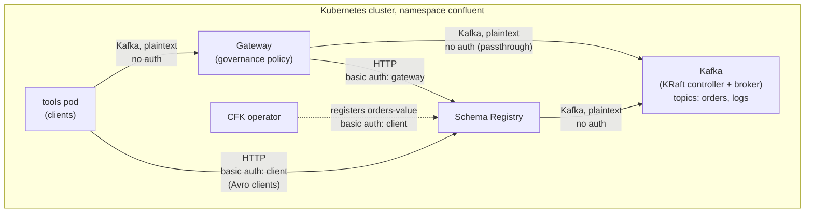

# Schema Validation with Gateway

This example shows Gateway centralized governance enforcement with:
- **Schema ID enforcement**: Gateway rejects records that do not have a schema ID.
- **Deep schema validation**: Gateway rejects records with a payload that does not agree with the schema.
- **Per-topic override**: Gateway does not govern the `logs` topic.

## Overview

The example deploys these components in the `confluent` namespace:

| Component       | Configuration                                                                          |
|-----------------|----------------------------------------------------------------------------------------|
| KRaft and Kafka | One controller and one broker, PLAINTEXT listeners                                     |
| Schema Registry | HTTP with basic authentication                                                         |
| Gateway         | Passthrough route, port-based routing, `policies.dataGovernance` with Schema Registry |
| Topics          | `orders` (governed) and `logs` (not governed)                                          |
| Schema          | `Order` Avro schema on the `orders-value` subject                                      |
| Tools pod       | Plain and Avro console tools                                                           |



Clients connect to Gateway at `confluent-gateway.confluent.svc.cluster.local:9092`. Gateway gets the schema of each record value from Schema Registry. The [gateway.yaml](./gateway.yaml) file sets the policy:

```yaml
policies:
  dataGovernance:
    schemaRegistry:
      urls:
        - http://schemaregistry.confluent.svc.cluster.local:8081
      authentication:
        type: basic
        basic:
          secretRef: gateway-sr-credentials
    key:
      enabled: false
    value:
      enabled: true
      subjectNameStrategy: TOPIC
    topics:
      - name: logs
        value:
          enabled: false
```

Schema ID enforcement and deep schema validation do not need Schema Registry extensions. For the licenses, see [Licenses](../README.md#licenses).

## Prerequisites

- Please ensure that you have set up the [prerequisites](https://github.com/confluentinc/confluent-kubernetes-examples/blob/master/README.md#prerequisites) for using the examples in this repo.
- CFK 3.4.0 or later. CFK 3.4.0 adds `policies.dataGovernance` to the Gateway CRD.
- Internet access from the cluster. The tools pod downloads the Confluent Community package.

## Deploy the Example

### Step 1: Deploy the Confluent for Kubernetes Operator

- Add the Confluent Helm repository
```
helm repo add confluentinc https://packages.confluent.io/helm
helm repo update
```
- Create the `confluent` namespace in the Kubernetes cluster
```
kubectl create namespace confluent
```
- Install the CFK operator
```
helm upgrade --install confluent-operator confluentinc/confluent-for-kubernetes -n confluent
```
- Check that the `confluent-operator` pod comes up and is running:
```
kubectl get pods -n confluent
```

### Step 2: Create the Schema Registry credentials

- Create the Schema Registry users. Schema Registry reads one `<user>: <password>,<role>` line for each user.
```
kubectl create secret generic sr-basic-users -n confluent \
  --from-literal=basic.txt=$'gateway: gateway-secret,sr-user\nclient: client-secret,sr-user'
```
- Create the credentials that Gateway uses to connect to Schema Registry
```
kubectl create secret generic gateway-sr-credentials -n confluent \
  --from-literal=basic.txt=$'username=gateway\npassword=gateway-secret'
```
- Create the credentials of the `client` user. CFK reads `basic.txt` to register the schema. The tools pod mounts `client.properties` for the Avro console tools.
```
kubectl create secret generic client-sr-credentials -n confluent \
  --from-literal=basic.txt=$'username=client\npassword=client-secret' \
  --from-literal=client.properties=$'basic.auth.credentials.source=USER_INFO\nbasic.auth.user.info=client:client-secret'
```

### Step 3: Deploy Kafka and Schema Registry

- Deploy the KRaft controller, Kafka and Schema Registry
```
kubectl apply -f confluent-platform.yaml
```
- Wait for the components to become RUNNING
```
kubectl wait --for=jsonpath='{.status.phase}'=RUNNING kraftcontroller/kraftcontroller kafka/kafka schemaregistry/schemaregistry --timeout=900s -n confluent
```

### Step 4: Create the topics and the schema

- Create the `orders` and `logs` topics
```
kubectl apply -f topics.yaml
```
- Register the `Order` schema on the `orders-value` subject
```
kubectl apply -f schema-config.yaml -f schema.yaml
```
- Wait for the schema to be registered
```
kubectl wait --for=jsonpath='{.status.state}'=SUCCEEDED schema/orders-value --timeout=300s -n confluent
```

### Step 5: Deploy Gateway

- Deploy the gateway yaml
```
kubectl apply -f gateway.yaml
```
- Wait for Gateway to become RUNNING
```
kubectl wait --for=jsonpath='{.status.phase}'=RUNNING gateway/confluent-gateway --timeout=600s -n confluent
```

### Step 6: Deploy the tools pod

- Deploy the tools pod
```
kubectl apply -f tools.yaml
```
- Wait for the tools pod to become READY. The pod is READY when the console tools are installed.
```
kubectl wait --for=condition=Ready pod/tools --timeout=900s -n confluent
```

## Testing the Configuration

1. Get the schema ID of the `orders-value` subject.
```
kubectl get schema orders-value -n confluent -o jsonpath='{.status.id}'
```

2. Open a shell in the tools pod. Run the next steps in this shell. Replace `<schema-id>` with the ID from step 1.
```
kubectl exec -it tools -n confluent -- bash
```
```
ID=<schema-id>
```

3. Produce an order with the plain console producer. This producer sends the JSON text with no schema ID.
```
echo '{"order_id": "o-1", "item": "keyboard", "quantity": 2}' | kafka-console-producer \
  --bootstrap-server confluent-gateway.confluent.svc.cluster.local:9092 \
  --topic orders
```
Gateway rejects the record:
```
org.apache.kafka.common.InvalidRecordException: confluent-gateway governance: origin=RECORD_SCHEMA_VALIDATION | Error deserializing schema ID
```

4. Produce the same order with the Avro console producer. This producer serializes the record with the registered schema and adds the schema ID.
```
echo '{"order_id": "o-1", "item": "keyboard", "quantity": 2}' | kafka-avro-console-producer \
  --bootstrap-server confluent-gateway.confluent.svc.cluster.local:9092 \
  --topic orders \
  --reader-property schema.registry.url=http://schemaregistry.confluent.svc.cluster.local:8081 \
  --reader-config /etc/sr-client/client.properties \
  --reader-property auto.register.schemas=false \
  --reader-property value.schema.id="$ID"
```
Gateway accepts the record.

5. Produce a record that has a valid schema ID and a payload that is not a valid `Order`. The record has the magic byte `0x00`, the 4-byte schema ID, and plain text.

> **Note:** The plain console producer encodes its input as UTF-8. Thus, this step works only when the schema ID is less than 128.

```
{ printf "\x00\x00\x00\x00\x$(printf %02x "$ID")"; echo 'not-valid-avro'; } | kafka-console-producer \
  --bootstrap-server confluent-gateway.confluent.svc.cluster.local:9092 \
  --topic orders
```
Gateway rejects the record:
```
org.apache.kafka.common.InvalidRecordException: confluent-gateway governance: origin=RECORD_SCHEMA_VALIDATION | Error deserializing Avro message for id SchemaId{schemaType='AVRO', id=1, guid='null', messageIndexes=null}
```

6. Consume `orders` through Gateway. The consumer shows only the Avro record from step 4.
```
kafka-avro-console-consumer \
  --bootstrap-server confluent-gateway.confluent.svc.cluster.local:9092 \
  --topic orders \
  --from-beginning \
  --formatter-property schema.registry.url=http://schemaregistry.confluent.svc.cluster.local:8081 \
  --formatter-config /etc/sr-client/client.properties
```

7. Produce a plain record to `logs`. Gateway does not govern `logs`, thus it accepts a record with no schema ID.
```
echo 'app started' | kafka-console-producer \
  --bootstrap-server confluent-gateway.confluent.svc.cluster.local:9092 \
  --topic logs
```

8. Consume `logs` through Gateway. The consumer shows the record from step 7.
```
kafka-console-consumer \
  --bootstrap-server confluent-gateway.confluent.svc.cluster.local:9092 \
  --topic logs \
  --from-beginning
```

9. Exit the tools pod. On the host, show the Gateway log lines for the rejected records.
```
kubectl logs deploy/confluent-gateway -n confluent | grep 'rejecting record'
```

## Clean Up

To remove all resources created by this example:

- Delete the tools pod, Gateway, schema, topics and Confluent Platform
```
kubectl delete -f tools.yaml -f gateway.yaml -f schema.yaml -f schema-config.yaml -f topics.yaml -f confluent-platform.yaml
```
- Delete the secrets
```
kubectl delete secret sr-basic-users gateway-sr-credentials client-sr-credentials -n confluent
```
- Uninstall the CFK operator
```
helm uninstall confluent-operator -n confluent
```
